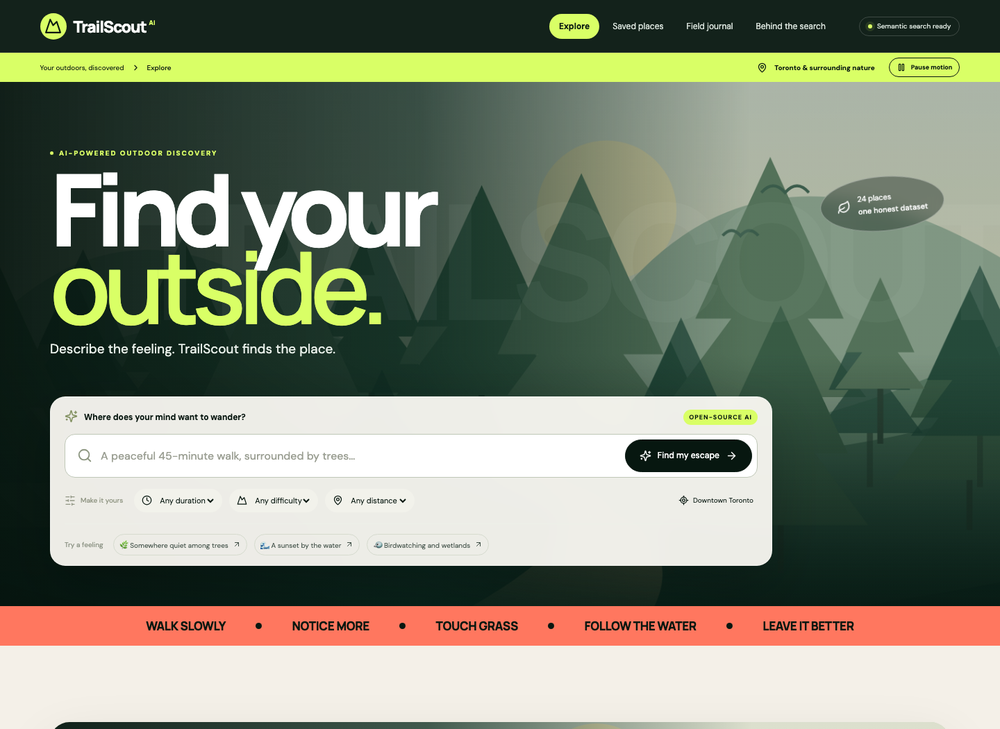
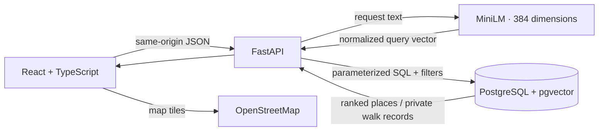

# TrailScout AI

**A little closer to outside.** Describe the outdoor break you want. TrailScout finds relevant Toronto-area nature outings using an open-weight embedding model and real PostgreSQL vector search.

Built for **MLH Global Hack Week: Hacktoberfest 2026**, with the [Implement AI-Powered Vector Search with pgvector challenge](https://www.mlh.com/events/global-hack-week-open-source-90/challenges/01a11b66-3a25-902e-3690-f9ea40cd5014) as the primary target.

> Working local MVP in a public GitHub repository. Tiger Cloud provisioning, deployment and submission remain user steps. Nothing has been deployed or submitted. See [verification](docs/verification.md) for tested functionality and limits.



## What it does

- **Semantic discovery:** MiniLM transforms requests such as “somewhere quiet under a leafy canopy” into 384-dimensional embeddings. PostgreSQL/pgvector ranks relevant place descriptions by cosine similarity.
- **Hard filters:** maximum walking time, difficulty, and straight-line radius from downtown Toronto or an explicitly requested browser location. A timezone-aware `recorded_after` API filter demonstrates time context.
- **Transparent results:** real cosine scores, model details, query timing, and explanations built from catalogue facts. No fake percentages or generated trail claims.
- **Explore:** 24 authored outings at real Toronto-area parks, interactive Leaflet/OpenStreetMap pins, place details, and external location links.
- **Save:** bookmarks persist in this browser's local storage.
- **Field journal:** completed dates, minutes, notes, aggregate totals, and deletion persist in PostgreSQL, isolated by an anonymous browser session.
- **Responsive editorial design:** a cinematic discovery hero, translucent search console, bold color fields, immersive result cards, keyboard controls, native focus-trapping detail dialogs, local fonts, and original nature illustrations.
- **Considerate motion:** slow hero drift and entrance transitions can be paused in the interface and are disabled when the operating system requests reduced motion.

**Scope:** It is a place finder, not a route-navigation system. Durations, walking lengths, difficulty and map points are editorial estimates. No route geometries, live closures, weather, driving times, guaranteed accessibility or availability. Natural-language text drives semantic ranking; use the explicit controls for hard limits. Only Toronto-area places are in the starter catalogue.

## Run on this prepared computer

From this `trailscout` directory:

```bash
./scripts/start-workspace.sh
```

Open **http://127.0.0.1:8000**. The helper reuses the isolated PostgreSQL server, Python environment, downloaded model, seeded data and frontend build prepared in this workspace. Press Ctrl+C to stop the web server. This convenience script is machine/workspace specific; the portable setup follows.

If port 8000 is already serving TrailScout, use that running instance instead of starting a second server. The workspace database uses loopback port 55432 and local trust authentication for disposable development data only. Do not expose it to the network.

## Portable native setup

Requirements: Python 3.13, Node.js 22.12+ (or a compatible newer version), PostgreSQL 17 with pgvector 0.8+, and internet access for initial dependency/model downloads. A fresh PostgreSQL database should use UTF-8.

```bash
python3 -m venv .venv
source .venv/bin/activate
python -m pip install -r backend/requirements-lock.txt
cp .env.example .env
```

Edit `.env` locally with your database connection string. Use a dedicated empty database and a migration role permitted to create the `vector` extension. Never commit `.env` or paste a connection string into screenshots. The frontend does not need any secret.

```bash
export PYTHONPATH=backend
python -m app.cli migrate
python -m app.cli seed
npm --prefix frontend ci
npm --prefix frontend run build
uvicorn app.main:app --host 127.0.0.1 --port 8000
```

Open http://127.0.0.1:8000. API documentation: http://127.0.0.1:8000/docs. Readiness: http://127.0.0.1:8000/api/health.

On Linux, installing a matching CPU-only PyTorch wheel first can avoid downloading CUDA libraries. The Docker/CI recipes describe this, but their exact Linux dependency path still requires validation in a Linux environment.

For frontend development, leave FastAPI running and run `npm --prefix frontend run dev` in a second terminal. Vite proxies `/api` to port 8000. Restart FastAPI after its code changes, or use `uvicorn app.main:app --reload` during development.

The first seed loads the pinned public model (~90 MB of weights, plus runtime dependencies). No Hugging Face token or paid AI key is required. Later starts reuse `HF_HOME`; set `HF_HUB_OFFLINE=1` after the first successful download to demonstrate without model network access. Map tiles still require internet access.

### Docker alternative (configuration supplied; not locally executed)

```bash
docker compose up --build
```

This builds the frontend, caches the model in the image, starts pgvector PostgreSQL, runs idempotent migration/seed, and starts the app on http://localhost:8000. `docker compose down` stops services while preserving the named database volume. The compose password and loopback bindings are for local development only. Docker was unavailable on the build machine, so native execution is the verified path.

## Test

Use a **dedicated migrated and seeded test database** for integration tests. They use the real model and pgvector and create/delete their own walk records. Do not point them at a production database.

```bash
# With .venv activated, from repository root:
export PYTHONPATH=backend
python -m pytest backend/tests -q
npm --prefix frontend run build

# Keep the backend running with the production frontend build, then:
cd frontend
npx playwright install chromium
npm run test:e2e
```

On the prepared computer, with the app running, `./scripts/test-workspace.sh` uses the existing local runtime and browser installation.

The backend suite checks semantic relevance, the reproducible keyword comparison, normalization and dimensions, direct mathematical agreement with PostgreSQL cosine scores, filter correctness, empty results, malicious input, timestamp validation, anonymous-session isolation, persistence, deletion, body limits, origin restrictions and throttling. Browser tests cover desktop and mobile search, saved places, journal persistence, map access, errors, retries and layout overflow. See [verification](docs/verification.md) for actual results.

GitHub Actions runs the same real-model/PostgreSQL integration path on Linux. Its first public run succeeded for commit `00d8d40` on October 10, 2026.

## Architecture



| Layer | Technology | Responsibility |
|---|---|---|
| Interface | React 19, TypeScript, Vite | Search, saved places, journal, original design |
| Maps | Leaflet, OpenStreetMap | Approximate park locations, zoom, keyboard-accessible pins |
| API | Python, FastAPI, Pydantic | Validated requests, bounded inference, sessions, errors |
| AI | Sentence Transformers, PyTorch CPU | Local open-weight sentence embeddings |
| Storage | PostgreSQL, pgvector, Psycopg pool | Cosine retrieval, hard filters, private journal persistence |
| Delivery | Single-origin FastAPI static build | One web service plus a database |

### Important decisions for your presentation

1. **Semantic search is the AI feature.** An embedding model places similar meanings near one another. This MVP does not need a generative chatbot or a paid inference service.
2. **PostgreSQL does the ranking.** This is not a Python list sorted to look like a vector database: the query executes `embedding <=> query_vector` inside PostgreSQL.
3. **Exact search fits 24 places.** It preserves recall after filters. An approximate HNSW/DiskANN index would add complexity without benefit at this size. [Architecture notes](docs/architecture.md) explain the growth path.
4. **Filters and meaning have different jobs.** The model understands text similarity; SQL enforces constraints. Dates represent catalogue ingestion, not live trail reports.
5. **Grounded explanations stay honest.** Durations, difficulty and tags explain the outing's characteristics. A score is raw cosine similarity, not a confidence percentage.
6. **One service simplifies deployment.** FastAPI serves the built React files and API under one origin. No database secret goes to the browser.
7. **The visual system supports the demo.** Large type establishes the product promise immediately; the search console stays above the fold; the map and recommendation cards share one dark content field; bright accents mark actions and semantic-search evidence. The supplied Adobe MAX and environmental dashboard references informed rhythm and hierarchy only. Their imagery, logos and interface assets are not included.

## Repository layout

```text
backend/app/       API, validation, embeddings, database queries, CLI, catalogue
backend/tests/     Real PostgreSQL + model integration tests
frontend/src/      Typed React UI, Leaflet integration, original SVG landscapes
frontend/e2e/      Desktop/mobile browser tests
db/               Idempotent schema and Tiger evidence queries
docs/             Architecture, deployment, demo, evidence, verification
scripts/          Prepared-workspace launch and test helpers
Dockerfile        Portable image recipe
compose.yaml      Local PostgreSQL + setup + web services
```

## API example

```bash
curl http://127.0.0.1:8000/api/search \
  -H 'Content-Type: application/json' \
  -d '{"query":"a quiet place among trees","max_minutes":45,"difficulty":"easy","latitude":43.6532,"longitude":-79.3832,"radius_km":10}'
```

Time filtering is available through `recorded_after`, for example `"2026-10-09T00:00:00Z"`; choose a date appropriate to your actual seeded database. No time filter is silently inferred from a user's prose.

## Deploy and demonstrate

- [Deployment and safe environment setup](docs/deployment.md)
- [90-second demo and MLH submission checklist](docs/demo-and-submission.md)
- [DEV Touch Grass article draft](docs/dev-touch-grass-submission.md)
- [DEV 60–90-second demo script](docs/dev-demo-script.md)
- [Tiger Cloud migration and evidence runbook](docs/tiger-cloud-evidence.md)
- [Verified Tiger Cloud evidence](docs/tiger-evidence.json)
- [Tiger Cloud retrieval evaluation](docs/tiger-retrieval-evaluation.json)
- [Measured semantic-versus-keyword evaluation](docs/retrieval-evaluation.md)
- [Prize and submission readiness](docs/submission-readiness.md)
- [Measured local database evidence](docs/local-evidence.json)
- [Actual verification results and remaining work](docs/verification.md)
- [Data and asset provenance](docs/data-and-credits.md)

Tiger Cloud migration, seed, TLS and semantic retrieval are verified. The remaining Tiger Data submission step is to run `db/tiger-evidence.sql` in the Tiger Cloud SQL editor and capture credential-free screenshots that visibly establish the cloud service context.

## AI tools and licensing

The embedding model is [sentence-transformers/all-MiniLM-L6-v2](https://huggingface.co/sentence-transformers/all-MiniLM-L6-v2), Apache-2.0, pinned to revision `1110a243fdf4706b3f48f1d95db1a4f5529b4d41`. Embeddings are generated at seed time and for queries at runtime. `trust_remote_code=False`; inference is CPU-based.

OpenAI Codex assisted with architecture, implementation, original illustrative artwork in SVG code, tests and documentation. No OpenAI API is used at runtime. Review and adapt the implementation before presenting it as your own work, and disclose AI assistance according to the event's rules.

Project code and original illustrations: MIT. Fonts, icons, maps and the model retain their own licenses; see [credits](docs/data-and-credits.md). The supplied reference images were used for visual direction only and are not included in the app.
